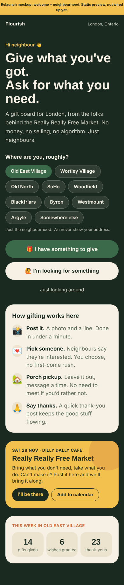
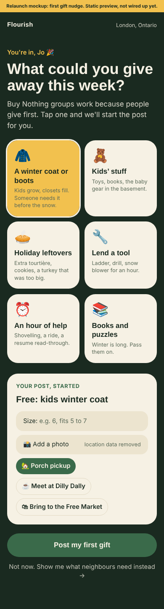
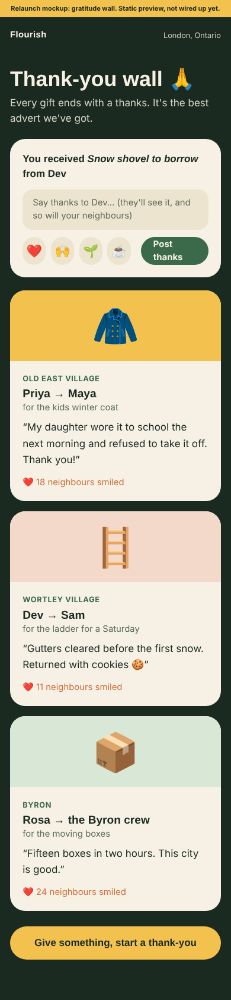
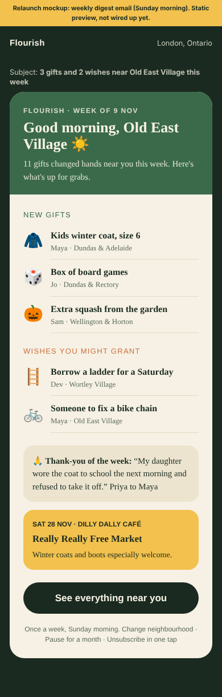
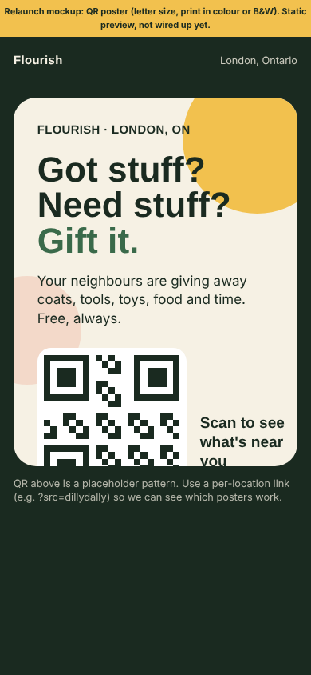

# Flourish relaunch review (Nov 2026)

**TL;DR.** Flourish works end to end and the bones are good: browse without an account, a 3-step post form, private messages, mark as given. But it reads like a dark, all-caps tech product, it never says it's for London, and a few small bugs make a new neighbour's first five minutes harder than they need to be. The bigger risk was safety: several database rules and API routes were far too open for an app that connects strangers who then meet in person. This branch fixes the clear-cut issues in code, adds a database migration that still has to be run by hand, and mocks five relaunch screens built around gift-first, Buy Nothing style culture and the **Really Really Free Market on Sat 28 Nov at Dilly Dally Café**.

Everything was tested locally against seed data with a stand-in for Supabase. Nothing touched production, nothing was sent, nothing was deployed.

- Mockups: run the app and open `/relaunch` (static, `noindex`, labelled as mockups)
- Screenshots: [`docs/preview/relaunch/`](docs/preview/relaunch/)

---

## 1. Findings, ranked

| # | Area | Finding | Status |
|---|------|---------|--------|
| 1 | Safety | Database access rules let any visitor change data they shouldn't (posts, replies, moderator list, SMS tables, vouch invites, vouch status) | **Fixed in migration `020_safety_hardening.sql`, not yet applied** |
| 2 | Safety | Several API routes (posting, reply notifications, SMS webhook, Facebook post, crons) trusted the caller instead of checking who they were | **Fixed in code** |
| 3 | Safety | Phone numbers of SMS posters were public | **Fixed** (code + migration moves them to a private table) |
| 4 | Safety | Reply messages were shown to everyone, and the reply box *invited* people to type their contact details | **Fixed**: only the poster and the replier see a reply's text; placeholder now says not to share address or number |
| 5 | Safety | No way to report a post or block a person | **Fixed**: Report post / Block neighbour on every post, backed by new `/api/report` and `/api/block` |
| 6 | Safety | Moderator actions silently did nothing (the "service" client was running as the signed-in user) | **Fixed** |
| 7 | Flow | Signing in from "Post something" dumped you on an empty "Your posts" page; you had to find your way back and tap Post again | **Fixed**: you land back on the board with the form already open |
| 8 | Bug | Filter bar clipped its first chips on phones (centred overflow row), and the active chip's text was the same colour as its background | **Fixed** |
| 9 | Flow | Your name wasn't prefilled when posting or replying (code looked for the wrong field), so you retyped it every time | **Fixed** |
| 10 | Flow | After replying, the post still said "No responses yet, be the first" | **Fixed** (page refreshes) |
| 11 | Flow | "Mark as given" only existed as a small **FULFILLED** button on the account page | **Fixed**: big "Mark as given" / "Sorted!" button on the post, plus a nudge to say thanks |
| 12 | Privacy | Message threads showed the other person's email prefix as their name | **Fixed** (uses profile name, falls back to "Neighbour") |
| 13 | Look | 156px blank header bars on the sign-in and post pages | **Fixed** |
| 14 | Look | Square, tiny, all-caps buttons and inputs | **Partly fixed**: rounder pill buttons, sheets and inputs, 40 to 56px tap targets. The all-caps type system is still there (see decisions) |
| 15 | Flow | The landing never says what Flourish is or where | **Partly fixed**: one plain line under the tagline. The full fix is the Welcome mockup |
| 16 | Flow | Someone who replies can't message the poster: they wait until the poster opens a thread. That's a dead end if the poster never does | **Open**: decision below |
| 17 | Flow | A returning poster gets no signal on the board that someone replied (no badge until a thread exists) | **Open** |
| 18 | Privacy | New accounts default their display name to the part of the email before the @ | **Partly fixed**: no longer prefilled into posts or replies. Onboarding should still ask for a first name (Welcome mockup) |
| 19 | Bug | Marking a post given showed "edited less than a minute ago" | **Fixed** |
| 19b | Bug | Search hid every legacy post (moderation status empty) and put raw search text into the database filter | **Fixed** |
| 20 | Safety | Some profile, reply and location columns are still readable more widely than they should be | **Open**: needs pages to select explicit columns first, then the columns can be locked down |
| 21 | Safety | No age confirmation, terms or privacy page; code of conduct doesn't mention minors | **Open**: decision below |
| 22 | Ops | No automated tests and no ESLint config in the repo (`npm run lint` asks to set one up) | **Open** |

## 2. Flow: before and after (390 x 844, scripted with Playwright)

Counted from the landing page with seed data. "Typed" is fields filled in.

| Step | Before | After |
|------|--------|-------|
| New neighbour: tap Post something → signed in → form open | 5 taps (lands on empty account page, back to board, Post again) | **3 taps** (form opens by itself) |
| First offer (form → live) | 4 taps, 2 fields (title + your name) | 4 taps, **1 field** (name prefilled) |
| First ask | 4 taps, 2 fields | 4 taps, **1 field** |
| Reply "I'm interested" | 3 taps, 2 fields, reply then invisible | 3 taps, **1 field**, reply shows up |
| Poster arranges pickup (sign in → post → message → send) | 5 taps | 5 taps (unchanged) |
| Mark as given | Account page → small FULFILLED button, no follow-up | **1 tap on the post**, thank-you nudge |

No scrolling was needed for any of these at phone size. At 1280 the layout holds up; the feed is a single centred column.

**Moments of doubt we saw (before):** "Did my magic link work?" (generic message, lands on an empty page); "Why am I typing my name again?"; "I replied, so why does it say no responses?"; "How do I tell them when to come?" (repliers can't message); "Where do I say it's gone?"; the dark all-caps hero gives no hint this is a London neighbour thing.

## 3. Safety summary

What's fixed in code on this branch:

- Posting, reply notifications, threads and messages need sign-in, and the author always comes from the session, never from the request
- Per-person rate limits on posts, replies, messages, reports and SMS
- SMS webhook checks the request really comes from Twilio. The Facebook auto-post and the cron routes need `CRON_SECRET`
- After a magic link, you can only be sent to a page on Flourish itself
- User text is escaped in all email templates. Clients get generic error messages
- Report and block, with blocks enforced in messaging
- Standard security headers (no framing, HSTS and similar)
- Posts sent to the browser no longer include phone numbers or exact coordinates, and reply text is only sent to the two people involved
- Photo uploads were already re-encoded through a canvas, which strips EXIF/GPS. The migration adds own-folder-only, image types only, 5MB max

What still needs doing (high level only, on purpose; details are in the PR handover):

- **Run `supabase/migrations/020_safety_hardening.sql`** on the live database after this code is deployed (code first, then the migration). Until then the database-level issues above are still live
- Lock down the remaining wide-open read columns once pages use explicit column lists
- Make vouch invite redemption atomic
- Age confirmation (18+, or a supervised-teen policy), terms and privacy page
- Decide what happens to a deleted account's posts (recommend: archive them)
- Remove `?secret=` from `vercel.json` crons (Vercel sends `Authorization: Bearer CRON_SECRET` itself)
- Drop leftover "potluck" tables if they still exist in production

**Heads-up on behaviour changes:** `/api/sms` rejects everything if `TWILIO_AUTH_TOKEN` isn't set (fine: the Twilio account is suspended anyway). Cron and Facebook routes reject everything without `CRON_SECRET`. Posting fails loudly, rather than quietly running with the public key, if `SUPABASE_SERVICE_ROLE_KEY` is missing.

Note: `supabase/migrations/019_post_images.sql` errors near the end when replayed (it inserts plain numbers into a JSON column). If it ran as-is in production, those `app_settings` rows may be missing.

## 4. Look and feel

**Today:** deep forest green, cream cards, Syne all-caps headings, tiny uppercase labels (0.6rem), square buttons. It's tasteful, but it reads "design studio", not "neighbour". There's no violet, which is good. The mood is closer to a members' club than a porch.

**Direction (shown in the mockups):** keep the forest green and cream (they already say London and trees), add a warm sun-yellow accent (`#f2c14e`) for celebrations and the Free Market, use sentence case, put real words in big round pill buttons at least 48px tall, use 20 to 28px card corners, and use emoji as friendly icons instead of tiny uppercase labels. Playful, not childish: no mascots, no cartoon fonts.

## 5. Getting people to actually use it

What Buy Nothing groups get right, and how it maps here:

1. **Gift first.** Ask new members to give before they ask. → *First gift nudge* (mocked): one-tap prompts for a winter coat, kids' stuff, holiday leftovers, lending a tool, an hour of help.
2. **Hyper-local.** It feels like your street, not your city. → *Neighbourhood picker* on welcome (mocked), with neighbourhood names on posts and the digest. Never an address.
3. **Porch pickup as the default.** Low-stakes handoffs, no need to meet. → A pickup chip on every post: 🏡 porch, ☕ meet at Dilly Dally, 🛍 bring to the Free Market (mocked in first gift).
4. **You choose who gets it.** No first-come rush, which rewards kindness over refresh speed. → Already true (the poster picks who to message). Say it out loud in "How gifting works".
5. **Gratitude posts.** The thank-you *is* the marketing. → *Thank-you wall* (mocked) plus the new "say thanks" nudge after Mark as given (built).
6. **Wishes.** Asking is part of the culture. → Rename "Need" to "Wish" in copy, and show "Wishes you might grant" in the digest (mocked).

Relaunch mechanics for London:

- **Launch moment: Really Really Free Market, Sat 28 Nov, Dilly Dally Café.** Banner on the board and in the digest (mocked). Table with a QR poster; "post it here and we'll bring it along" for people who can't attend; a laptop or phone at the table to help first posts happen on the spot.
- **QR posters** (mocked) at Dilly Dally, London Public Library branches, the Old East Village Grocer, laundromats and community centres. Use a per-location link (`?src=dillydally`) to see which ones work.
- **Weekly digest email** (mocked), Sunday morning, per neighbourhood, with one-tap pause or unsubscribe. The existing `/api/digest` route is a start; it needs neighbourhood grouping and an opt-in.
- **Seasonal prompts:** winter coats and boots (Nov), holiday leftovers and wrapping (Dec), snow shovels and blowers to lend (Jan), seeds and seedlings (spring).
- **Seed the board before launch:** 20 to 30 real gifts from the RRFM crew in the week before 28 Nov, so nobody lands on an empty board.

### Mocked screens (on this branch, `/relaunch`)

| Welcome + neighbourhood | First gift | Thank-you wall | Weekly digest | QR poster |
|---|---|---|---|---|
|  |  |  |  |  |

## 6. What Heenal needs to decide

1. **Run the safety migration?** It's needed before relaunch. Someone with database access runs `020_safety_hardening.sql` after deploying this code. Test on a Supabase branch first if you can.
2. **Can repliers message first?** Today only the poster can open a conversation. Buy Nothing culture says the giver chooses, which argues for keeping it, but then the poster needs a clear "you have 3 interested neighbours" nudge. The other option is to let repliers send one message.
3. **Vouch gate on or off at launch?** It's off in seed data. On is safer but adds friction at the Free Market. Option: anyone who signs up at the RRFM table gets vouched in person.
4. **Age policy:** 18+ only, or allow teens with a guardian? This affects sign-up copy and the code of conduct.
5. **"Need" or "Wish"?** And should the dark theme stay the default, or should the warm light theme lead?
6. **Domain and name:** README says `flourish.ourlondon.xyz`, the brief says `flourish.community`. Pick one for the posters.
7. **Who moderates?** Reports now email `ADMIN_EMAIL`. You need at least two named moderators with a response-time promise before the Free Market.
8. **SMS posting:** drop it (Twilio is suspended), or replace it?

## 7. Not done / next

- The mockups are static. Wiring up the neighbourhood picker, first gift, thank-you posts and the per-neighbourhood digest is the next sprint
- No automated test suite exists. Add Playwright smoke tests for the flows above
- The full type-system refresh (sentence case, bigger labels) across all pages
